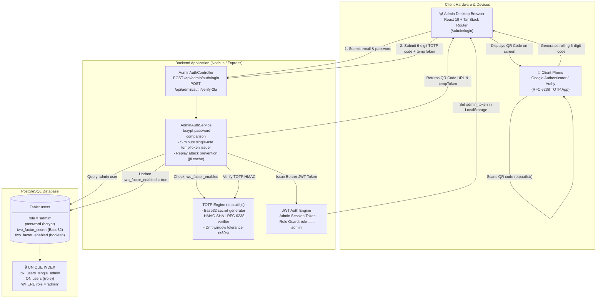
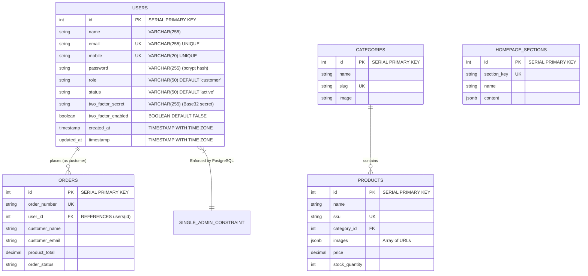
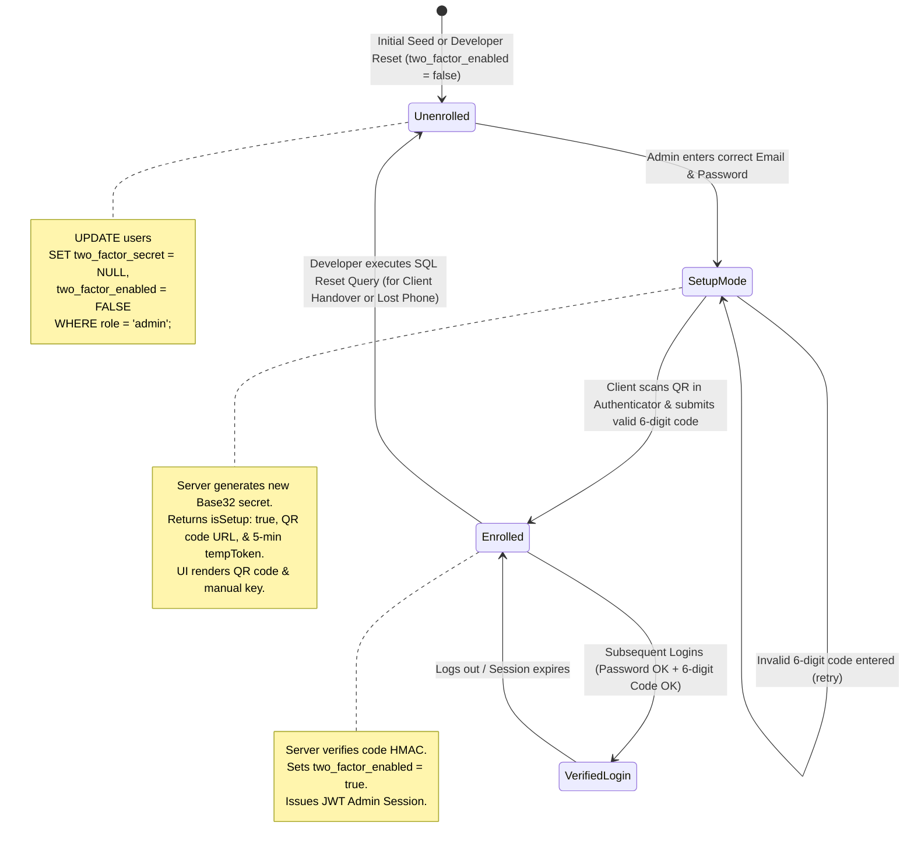
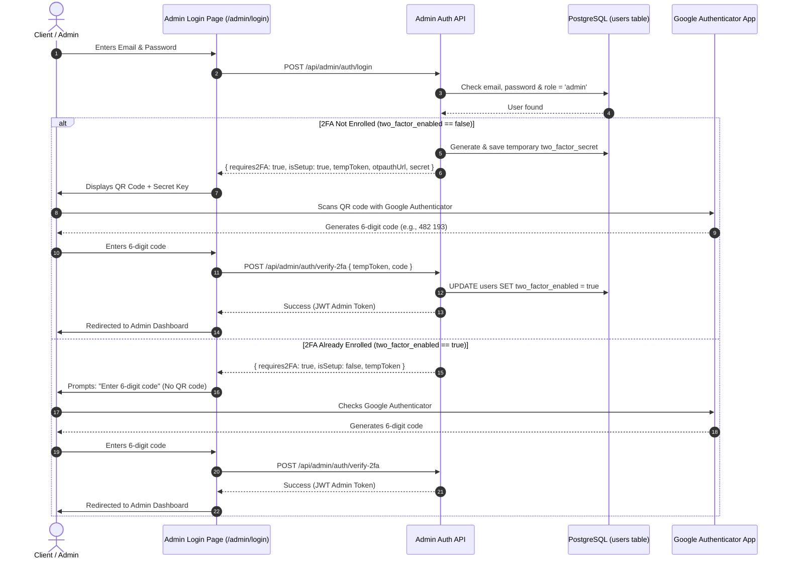
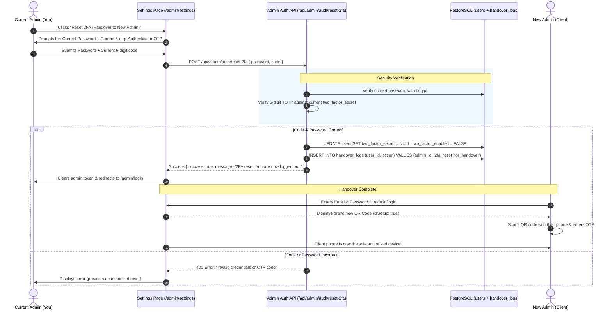
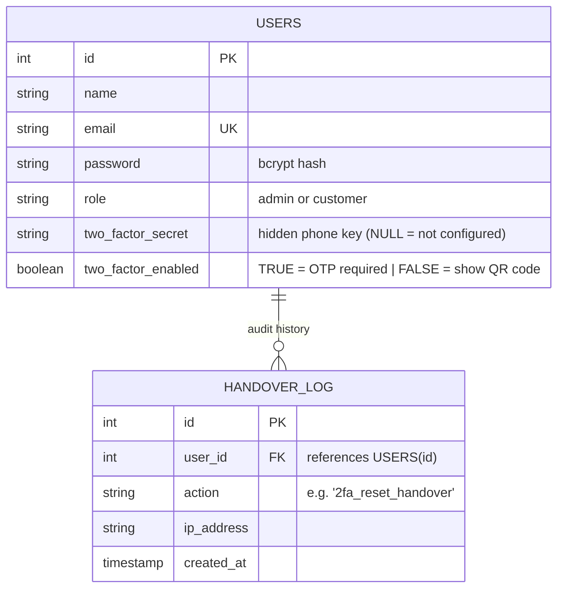

# Admin Account Handover & Google Authenticator (2FA) Guide

This guide explains how to transfer the Mubarak Studio administrator account to your client, how the 2FA (Google Authenticator) system operates, and how to reset or re-bind the authenticator to a new device.

---

## 1. System Architecture & Constraints

Before starting, keep in mind two key architectural design features in the system:

1. **Strict Single-Admin Rule** ([`backend/src/database/init.js`](backend/src/database/init.js)):
   ```sql
   CREATE UNIQUE INDEX idx_users_single_admin ON users ((role)) WHERE role = 'admin';
   ```
   * Only **one** user can hold the `admin` role at any time.
   * Do not try to register a second admin account; instead, **update the existing admin record** with the client's information.

2. **Two-Factor Authentication (TOTP / Google Authenticator)** ([`backend/src/modules/admin/auth/admin-auth.service.js`](backend/src/modules/admin/auth/admin-auth.service.js)):
   * Admin login is a **2-step process**:
     * **Step 1:** Validate Email / Username + Password.
     * **Step 2:** Validate 6-digit Time-Based One-Time Password (TOTP) from Google Authenticator.
   * When `two_factor_enabled = false` (or unset), the system enters **Setup Mode** (`isSetup: true`), generating a fresh QR code and secret key.
   * Once a valid 6-digit code is verified, `two_factor_enabled` flips to `true` and the QR code is hidden on future logins.

---

## 2. System Design Diagram



---

## 3. Entity-Relationship (ER) Diagram



> **Database Constraint Detail:**
> * `idx_users_single_admin`: Partial unique index `CREATE UNIQUE INDEX idx_users_single_admin ON users ((role)) WHERE role = 'admin';` guarantees that multiple rows can never have `role = 'admin'`.
> * `two_factor_secret`: Holds the RFC 6238 160-bit Base32 secret string.
> * `two_factor_enabled`: Boolean flag indicating whether the initial QR code scanning handshake has been completed.

---

## 4. 2FA State Machine (Lifecycle)



---

## 5. How the Authenticator Works After Entering Username & Password



---

## 6. How to Reset / Change the Authenticator for Handover

You have two ways to reset 2FA:
1. **In-App Button (Recommended & Safest):** Inside the Admin Settings page without touching the database.
2. **Direct SQL Query (Fallback):** Directly in PostgreSQL if locked out.

---

### Method A: In-App UI Reset Button (Safe & Developer-Free)

Instead of opening the database manually, you can use the **"Reset 2FA (Handover to New Admin)"** button inside **Admin Settings**.



#### Why ask for the current OTP before resetting?
If a malicious user obtained the admin password, they could log in, hit "Reset 2FA", and hijack the account. Requiring the **live 6-digit OTP** guarantees that only the person physically holding the currently registered authenticator phone can authorize a handover reset.

---

### Simplified ER Diagram (Handover & 2FA State)



* **`USERS`**: The same table as before. The two fields (`two_factor_secret` and `two_factor_enabled`) control the entire state. Setting `two_factor_secret = NULL` and `two_factor_enabled = FALSE` triggers the setup QR code on the next login.
* **`HANDOVER_LOG`**: A security diary that records when 2FA was reset, providing proof and audit compliance.

---

### Method B: Direct SQL Query (Emergency / Fallback)

If the active phone is broken, lost, or inaccessible, run this single SQL query in PostgreSQL:

```sql
UPDATE users
SET 
  two_factor_secret = NULL,
  two_factor_enabled = FALSE
WHERE role = 'admin';
```

---

### What the Client Experiences on Next Login
1. Client visits `/admin/login`.
2. Enters admin email and password.
3. Because `two_factor_enabled` is now `FALSE`, the screen immediately presents:
   - A **QR Code** titled **"Setup Step: Scan in Authenticator"**.
   - A **Secret Key** string for manual entry.
4. Client opens **Google Authenticator** (or Authy) on their phone, scans the QR code, and types the 6-digit code.
5. The system saves `two_factor_enabled = TRUE`. From that second forward, **only the client's phone** can generate valid login codes.

---

## 7. Complete End-to-End Client Handover Procedure

Follow this checklist for a clean handover:

### Step 1: Update the Admin Record in Database
Set the client's email, name, mobile, a temporary password, and reset 2FA:

```sql
-- Note: Replace 'TempPassword2026!' with your chosen temporary password hash,
-- or run the Node script below to generate a hashed password.
UPDATE users
SET 
  name = 'Client Name',
  email = 'client@company.com',
  mobile = '+91 9876543210',
  two_factor_secret = NULL,
  two_factor_enabled = FALSE
WHERE role = 'admin';
```

#### To set a new temporary password hash:
Run this one-line command in PowerShell / terminal inside the `backend` folder:
```powershell
node -e "bcrypt = require('bcrypt'); console.log(bcrypt.hashSync('ClientTempPassword123!', 10));"
```
Then copy that hash and update the password column:
```sql
UPDATE users SET password = '<PASTE_HASH_HERE>' WHERE role = 'admin';
```

### Step 2: Update Server Configuration (`.env`)
Update the fallback admin credentials in your production/server `.env`:
```env
ADMIN_EMAIL=client@company.com
ADMIN_PASSWORD=ClientTempPassword123!
```

### Step 3: Send Handover Instructions to the Client

You can copy and send this message template to your client:

> **Subject: Your Mubarak Studio Admin Access & Setup Instructions**
>
> Dear [Client Name],
>
> Your administrator portal is ready. Here are your login credentials:
>
> - **Portal URL:** `https://yourdomain.com/admin/login`
> - **Email:** `client@company.com`
> - **Temporary Password:** `ClientTempPassword123!`
>
> **First-Time Login Steps:**
> 1. Download **Google Authenticator** on your phone (available on Apple App Store & Google Play Store).
> 2. Open the Portal URL above and enter your Email and Temporary Password.
> 3. You will see a **QR Code**. Open Google Authenticator, tap **+**, and scan the QR code.
> 4. Enter the 6-digit code shown in the app to complete login.
> 5. Once inside, visit **Settings** -> **Change Password** to set your own private password.

---

## 8. How the Client Changes Their Password Afterwards

The client can change their password directly from the admin dashboard without developer intervention:

1. Log in to the Admin Dashboard.
2. Go to **Settings** (or call `/api/admin/settings/password`).
3. Enter:
   - **Current Password** (the temporary password you gave them).
   - **New Password** (their new secure password).
   - **Confirm Password**.
4. Click **Update Password**.

---

## 9. Emergency Recovery & Troubleshooting

| Problem | Cause | Solution |
|---|---|---|
| **"Invalid Google Authenticator code"** | Time drift on client's phone. TOTP codes expire every 30 seconds and require accurate clock sync. | Ask the client to enable **"Set Time Automatically"** in their phone system settings, or in Google Authenticator -> Settings -> **Time correction for codes** -> Sync now. |
| **Client lost their phone / new device** | The authenticator app is bound to the old physical device. | Run the reset SQL query from Section 3: `UPDATE users SET two_factor_secret = NULL, two_factor_enabled = FALSE WHERE role = 'admin';`. They can re-scan a new QR code on their next login. |
| **Client forgot password** | Password forgotten. | Generate a new bcrypt hash using the command in Step 1 and update `password` in PostgreSQL. |
