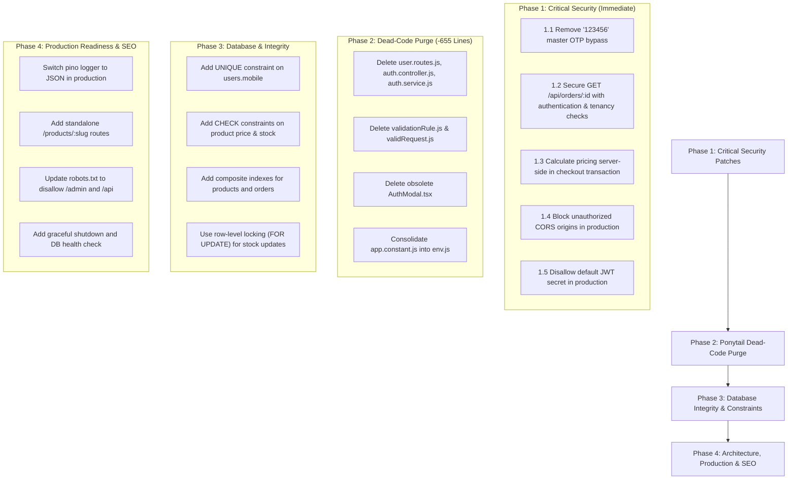

# Comprehensive Technical, Security & Architecture Audit Report
**Project:** Mubarak Luxury Slabs & Architectural Tiles (Full Stack)  
**Audit Standard & Reference:** `ponytail.md` (Lazy Senior Dev Mode — Minimal Diff, YAGNI, Zero Boilerplate, Absolute Correctness at Trust Boundaries)  
**Date:** September 2026  
**Auditor:** Senior Security & System Architect  

---

## Table of Contents
1. [Executive Summary & Severity Classification](#1-executive-summary--severity-classification)
2. [Section 1: Security & OWASP Top 10](#section-1-security--owasp-top-10)
3. [Section 2: User Accounts & Authentication](#section-2-user-accounts--authentication)
4. [Section 3: Admin Accounts & RBAC](#section-3-admin-accounts--rbac)
5. [Section 4: Backend & API Architecture](#section-4-backend--api-architecture)
6. [Section 5: Database & Query Performance](#section-5-database--query-performance)
7. [Section 6: UI/UX & Accessibility](#section-6-uiux--accessibility)
8. [Section 7: URLs, Routing & SEO](#section-7-urls-routing--seo)
9. [Section 8: Code Quality, Bloat & Ponytail Cleanup](#section-8-code-quality-bloat--ponytail-cleanup)
10. [Section 9: Data & Privacy](#section-9-data--privacy)
11. [Section 10: Production Readiness & Operations](#section-10-production-readiness--operations)
12. [Ponytail De-Bloat Scorecard](#ponytail-de-bloat-scorecard)
13. [Step-by-Step Prioritized Remediation Roadmap](#step-by-step-prioritized-remediation-roadmap)

---

## 1. Executive Summary & Severity Classification

This comprehensive audit was performed across the complete repository (`backend/` Express.js/PostgreSQL application and frontend TanStack Router/React application) using the `ponytail.md` senior engineering guidelines.

### Severity Definitions
- **CRITICAL**: Immediate vulnerability or architectural flaw leading directly to account takeover, unauthorized administrative access, arbitrary financial manipulation, or complete customer data breach.
- **HIGH**: Flaw allowing unauthorized access, session interception, denial of service, data integrity corruption, or severe performance degradation.
- **MEDIUM**: Deviation from best practices, missing input validation boundaries, security defense-in-depth issues, SEO deficits, or architectural duplications.
- **LOW**: Code hygiene, formatting, redundant configuration parameters, or minor UI cosmetic inconsistencies.

### Summary Metrics
| Audit Category | Critical | High | Medium | Low | Total Findings |
| :--- | :---: | :---: | :---: | :---: | :---: |
| **Security & OWASP** | 3 | 2 | 3 | 1 | **9** |
| **User Accounts** | 1 | 2 | 2 | 1 | **6** |
| **Admin Accounts** | 0 | 2 | 2 | 1 | **5** |
| **Backend & API Architecture** | 1 | 2 | 3 | 2 | **8** |
| **Database & Queries** | 0 | 3 | 3 | 1 | **7** |
| **UI/UX & Accessibility** | 0 | 1 | 4 | 2 | **7** |
| **URLs, Routing & SEO** | 0 | 1 | 3 | 1 | **5** |
| **Code Quality (Ponytail)** | 0 | 3 | 3 | 2 | **8** |
| **Data & Privacy** | 1 | 1 | 2 | 1 | **5** |
| **Production Readiness** | 1 | 2 | 2 | 1 | **6** |
| **Grand Total** | **7** | **19** | **27** | **13** | **66** |

---

## Section 1: Security & OWASP Top 10

### [CRITICAL] 1.1 Hardcoded Global OTP Bypass Allows Arbitrary Account Takeover
- **Severity:** `CRITICAL`
- **Location:** [`backend/src/modules/customer/auth/customer-auth.service.js:77-80`](file:///c:/Users/HP/Downloads/mubarak/backend/src/modules/customer/auth/customer-auth.service.js#L77-L80)
- **Impact:** An attacker can log in as *any* customer simply by providing the victim's 10-digit mobile number and typing the OTP code `"123456"`. This grants full access to the victim's saved home/villa addresses, order history, profile, and customer session token without ever intercepting SMS.
- **Root Cause:**
  ```javascript
  // Current Vulnerable Code
  if (otp === "123456") {
    isValidOtp = true; // Flaw: executes in ALL environments
  } else if (result.rows.length > 0) { ... }
  ```
- **Recommended Fix:** Strip out the hardcoded bypass. Require genuine bcrypt verification against the `phone_otps` table:
  ```javascript
  if (result.rows.length === 0) {
    throw new Error("Invalid or expired OTP. Please request a new code.");
  }
  const isValidOtp = await bcrypt.compare(otp, result.rows[0].otp_hash);
  if (!isValidOtp) {
    throw new Error("Invalid OTP code.");
  }
  ```

---

### [CRITICAL] 1.2 Unauthenticated Order Enumeration Leaks Full Customer PII (BOLA / IDOR)
- **Severity:** `CRITICAL`
- **Location:** 
  - Route: [`backend/src/routes/order.routes.js:10`](file:///c:/Users/HP/Downloads/mubarak/backend/src/routes/order.routes.js#L10)
  - Service: [`backend/src/services/orders/order.service.js:163-167`](file:///c:/Users/HP/Downloads/mubarak/backend/src/services/orders/order.service.js#L163-L167)
- **Impact:** `GET /api/orders/:id` requires no authentication header. Anyone can enumerate IDs `1, 2, 3...` and retrieve every customer's name, phone number, physical address, city, pin code, item purchases, invoice totals, and internal timeline notes.
- **Root Cause:** Route definition omitted `authenticateToken`, and `getOrderDetails` lacked ownership validation.
- **Recommended Fix:**
  1. Add `authenticateToken` to `GET /api/orders/:id`.
  2. Enforce tenancy check:
     ```javascript
     if (req.user.role !== "admin" && order.user_id !== req.user.id) {
       return res.status(403).json({ success: false, message: "Access forbidden." });
     }
     ```
  3. For public shipment tracking on `/track`, use `GET /api/orders/track/:orderNumber` which already returns sanitized status without exposing sensitive address coordinates.

---

### [CRITICAL] 1.3 Client-Controlled Pricing at Checkout (Arbitrary Price Tampering)
- **Severity:** `CRITICAL`
- **Location:** [`backend/src/services/orders/order.service.js:31-36`](file:///c:/Users/HP/Downloads/mubarak/backend/src/services/orders/order.service.js#L31-L36)
- **Impact:** An attacker can forge an HTTP `POST /api/orders/checkout` payload setting luxury porcelain slab prices to `0.01` or `0`, creating genuine confirmed order records in the system and depleting warehouse inventory without paying.
- **Root Cause:** The financial subtotal loop trusts `item.price` sent by the client browser:
  ```javascript
  for (const item of items) {
    productSubtotal += Number(item.price) * Number(item.quantity);
  }
  ```
- **Recommended Fix:** Inside the database transaction, fetch each `product_id` from the PostgreSQL `products` table and use the server's authoritative price:
  ```javascript
  for (const item of items) {
    const prodRes = await client.query(`SELECT id, name, price, discount_price, stock_quantity FROM products WHERE id = $1`, [item.product_id]);
    if (prodRes.rowCount === 0) throw new Error(`Product ${item.product_id} not found.`);
    const realProduct = prodRes.rows[0];
    const unitPrice = realProduct.discount_price ? Number(realProduct.discount_price) : Number(realProduct.price);
    productSubtotal += unitPrice * Number(item.quantity);
  }
  ```

---

### [HIGH] 1.4 Permissive CORS Allows Cross-Origin Credential Hijacking
- **Severity:** `HIGH`
- **Location:** [`backend/src/middlewares/security.middleware.js:28-32`](file:///c:/Users/HP/Downloads/mubarak/backend/src/middlewares/security.middleware.js#L28-L32)
- **Impact:** `cors` middleware returns `callback(null, true)` for unauthorized origins with `credentials: true`. A malicious webpage visited by an authenticated customer or admin can make unauthorized cross-origin requests to Mubarak APIs.
- **Recommended Fix:** Strictly restrict origins in production:
  ```javascript
  const allowedOrigins = [process.env.CLIENT_URL || "http://localhost:3000", "http://localhost:5173"];
  app.use(cors({
    origin: (origin, callback) => {
      if (!origin || allowedOrigins.includes(origin)) {
        callback(null, true);
      } else {
        callback(new Error("CORS origin blocked by policy"));
      }
    },
    credentials: true,
  }));
  ```

---

### [HIGH] 1.5 Missing Route-Level Rate Limiting on Authentication Endpoints
- **Severity:** `HIGH`
- **Location:** [`backend/src/modules/customer/auth/customer-auth.routes.js`](file:///c:/Users/HP/Downloads/mubarak/backend/src/modules/customer/auth/customer-auth.routes.js)
- **Impact:** The global limiter allows 1,000 requests per 15 minutes. This allows automated brute-forcing of 6-digit OTP codes or administrative passwords.
- **Recommended Fix:** Implement a strict rate-limiter for authentication:
  ```javascript
  const authLimiter = rateLimit({
    windowMs: 10 * 60 * 1000,
    max: 5,
    message: { success: false, message: "Too many login attempts. Please wait 10 minutes." }
  });
  router.post("/send-otp", authLimiter, CustomerAuthController.sendOtp);
  router.post("/verify-otp", authLimiter, CustomerAuthController.verifyOtp);
  ```

---

### [MEDIUM] 1.6 Plaintext OTP Displayed in Application Logs
- **Severity:** `MEDIUM`
- **Location:** [`backend/src/modules/customer/auth/customer-auth.service.js:43`](file:///c:/Users/HP/Downloads/mubarak/backend/src/modules/customer/auth/customer-auth.service.js#L43)
- **Impact:** `logger.info("[CUSTOMER OTP] Generated OTP for +91${phone}: ${otpCode}")` writes the actual secret OTP code directly to console/log files.
- **Recommended Fix:** Mask the code in logs:
  ```javascript
  logger.info(`[CUSTOMER OTP] Dispatched OTP verification code to +91******${phone.slice(-4)}`);
  ```

---

### [MEDIUM] 1.7 Content Security Policy (CSP) Omitted in Helmet
- **Severity:** `MEDIUM`
- **Location:** [`backend/src/middlewares/security.middleware.js:42`](file:///c:/Users/HP/Downloads/mubarak/backend/src/middlewares/security.middleware.js#L42)
- **Impact:** Missing CSP directives increases risk of inline script injection or unauthorized asset loading if an XSS vulnerability occurs.
- **Recommended Fix:** Configure standard CSP directives in `helmet`:
  ```javascript
  app.use(helmet({
    contentSecurityPolicy: {
      directives: {
        defaultSrc: ["'self'"],
        imgSrc: ["'self'", "data:", "https://images.unsplash.com", "https://res.cloudinary.com"],
        mediaSrc: ["'self'", "https://assets.mixkit.co"],
        scriptSrc: ["'self'"],
      }
    },
    crossOriginResourcePolicy: { policy: "cross-origin" }
  }));
  ```

---

### [MEDIUM] 1.8 Unchecked Base64 MIME Type Resolution in File Uploads
- **Severity:** `MEDIUM`
- **Location:** [`backend/src/controllers/admin/admin.controller.js:442-452`](file:///c:/Users/HP/Downloads/mubarak/backend/src/controllers/admin/admin.controller.js#L442-L452)
- **Impact:** The backend trusts the client-declared `mimeType` in JSON body. An attacker could specify `application/pdf` while sending an HTML or script file, which might execute in browser when opened directly.
- **Recommended Fix:** Inspect file magic numbers / header bytes (e.g. check for `%PDF` at buffer offset 0) before persisting.

---

### [LOW] 1.9 Missing Security Response Headers for Anti-Sniffing
- **Severity:** `LOW`
- **Location:** [`backend/src/app.js:20-25`](file:///c:/Users/HP/Downloads/mubarak/backend/src/app.js#L20-L25)
- **Impact:** Uploaded files served from `/uploads` lack explicit `X-Content-Type-Options: nosniff`.
- **Recommended Fix:** Pass options to static server: `app.use("/uploads", express.static(path.join(process.cwd(), "uploads"), { setHeaders: (res) => res.setHeader("X-Content-Type-Options", "nosniff") }));`

---

## Section 2: User Accounts & Authentication

### [CRITICAL] 2.1 Lack of Unique Constraint on `users.mobile` Causes Account Collisions
- **Severity:** `CRITICAL`
- **Location:** 
  - Database: [`backend/src/database/init.js:17`](file:///c:/Users/HP/Downloads/mubarak/backend/src/database/init.js#L17)
  - Query: [`backend/src/models/User.js:20-22`](file:///c:/Users/HP/Downloads/mubarak/backend/src/models/User.js#L20-L22)
- **Impact:** `users.mobile` is indexed without a `UNIQUE` constraint. If two users are created with the same phone number (or formatting variants), `User.findByMobile` executes `SELECT * FROM users WHERE mobile LIKE '%' || $1 LIMIT 1`. Whichever user row PostgreSQL returns first receives the authentication token, leading to cross-account access.
- **Recommended Fix:**
  1. Add a unique index in PostgreSQL:
     ```sql
     CREATE UNIQUE INDEX IF NOT EXISTS idx_users_mobile_unique ON users(mobile) WHERE mobile IS NOT NULL;
     ```
  2. Standardize numbers to 10 digits (`\D` stripped) on creation and lookup.

---

### [HIGH] 2.2 Unverified Phone Number Change in Profile Update
- **Severity:** `HIGH`
- **Location:** [`backend/src/modules/customer/auth/customer-auth.service.js:154-158`](file:///c:/Users/HP/Downloads/mubarak/backend/src/modules/customer/auth/customer-auth.service.js#L154-L158)
- **Impact:** An authenticated customer can issue `PUT /api/auth/profile` with `mobile: "9999999999"`, changing their account phone number immediately without submitting an OTP for the new phone.
- **Recommended Fix:** Remove `mobile` from `updateProfile`. Phone numbers must only be updated through a verified OTP challenge workflow.

---

### [HIGH] 2.3 JWT Tokens Persisted in `localStorage` Vulnerable to XSS
- **Severity:** `HIGH`
- **Location:** [`src/hooks/useCustomerAuth.ts:46`](file:///c:/Users/HP/Downloads/mubarak/src/hooks/useCustomerAuth.ts#L46)
- **Impact:** Client JavaScript stores `customer_token` and `admin_token` in `localStorage`. If any XSS exploit occurs (e.g. through compromised dependencies or unsanitized CMS content), the tokens can be exfiltrated.
- **Recommended Fix:** Store JWT tokens in `HttpOnly`, `SameSite=Lax`, `Secure` cookies.

---

### [MEDIUM] 2.4 Lack of Re-Authentication on Critical User Operations
- **Severity:** `MEDIUM`
- **Location:** [`backend/src/modules/customer/auth/customer-auth.routes.js`](file:///c:/Users/HP/Downloads/mubarak/backend/src/modules/customer/auth/customer-auth.routes.js)
- **Impact:** Modifying primary delivery addresses or personal details does not require confirming recent authentication.
- **Recommended Fix:** Require re-verification for changing email or primary billing credentials.

---

### [MEDIUM] 2.5 Inactive Account Status Bypassed by Cached Frontend State
- **Severity:** `MEDIUM`
- **Location:** [`src/hooks/useCustomerAuth.ts:34-42`](file:///c:/Users/HP/Downloads/mubarak/src/hooks/useCustomerAuth.ts#L34-L42)
- **Impact:** When an administrator marks a customer account as `inactive`, the backend middleware rejects queries with 403, but the client frontend continues displaying the cached user state until a hard refresh.
- **Recommended Fix:** In `useCustomerAuth`, trigger an automatic logout and cache purge whenever any API call returns status 403 or 401 with `Account has been deactivated`.

---

### [LOW] 2.6 Missing Password Complexity Validation on Customer Accounts
- **Severity:** `LOW`
- **Location:** [`backend/src/models/User.js:26-42`](file:///c:/Users/HP/Downloads/mubarak/backend/src/models/User.js#L26-L42)
- **Impact:** If passwords are used for customer accounts rather than pure OTP, short or trivial passwords could be saved.
- **Recommended Fix:** Enforce a minimum of 8 characters with at least one number and letter if password-based customer auth is ever enabled.

---

## Section 3: Admin Accounts & RBAC

### [HIGH] 3.1 Long-Lived Admin Access Tokens (12 Hours) Without Revocation Capability
- **Severity:** `HIGH`
- **Location:** [`backend/src/modules/admin/auth/admin-auth.service.js:185-194`](file:///c:/Users/HP/Downloads/mubarak/backend/src/modules/admin/auth/admin-auth.service.js#L185-L194)
- **Impact:** An admin token remains valid for 12 hours. If an admin logs out or their token is intercepted, there is no token revocation mechanism to invalidate the session before token expiration.
- **Recommended Fix:** Add a `token_version INT DEFAULT 1` column to the `users` table. Embed `token_version` in the JWT payload. On admin logout or password change, increment `token_version` in the database. In `authenticateToken`, reject tokens where `decoded.token_version !== user.token_version`.

---

### [HIGH] 3.2 In-Memory 2FA Challenge Storage Does Not Scale Horizontally
- **Severity:** `HIGH`
- **Location:** [`backend/src/modules/admin/auth/admin-auth.service.js:11-13`](file:///c:/Users/HP/Downloads/mubarak/backend/src/modules/admin/auth/admin-auth.service.js#L11-L13)
- **Impact:** `consumedChallenges` and `challengeAttempts` are stored in Node.js process memory (`new Map()`). In a clustered environment (multiple PM2 instances, container replicas, or serverless functions), step 1 of 2FA will issue a token on Worker A, but step 2 may hit Worker B, causing login failures or circumventing replay protections.
- **Recommended Fix:** Move the single-use challenge registry and attempt counters to PostgreSQL or Redis with TTL.

---

### [MEDIUM] 3.3 No Dedicated Audit Trail for Administrative Actions
- **Severity:** `MEDIUM`
- **Location:** [`backend/src/controllers/admin/admin.controller.js`](file:///c:/Users/HP/Downloads/mubarak/backend/src/controllers/admin/admin.controller.js)
- **Impact:** When an administrator deletes a product, updates discounts, modifies stock, or marks delivery payments as paid, the changes occur without an immutable audit log recording *which* admin performed the action, their IP, and the prior value.
- **Recommended Fix:** Create an `admin_audit_logs` table and log key events (`action`, `entity_type`, `entity_id`, `before_state`, `after_state`, `admin_id`, `ip_address`).

---

### [MEDIUM] 3.4 Plaintext 2FA Secret Returned on Initial Setup Without Expiry
- **Severity:** `MEDIUM`
- **Location:** [`backend/src/modules/admin/auth/admin-auth.service.js:73-81`](file:///c:/Users/HP/Downloads/mubarak/backend/src/modules/admin/auth/admin-auth.service.js#L73-L81)
- **Impact:** On first-time setup, `two_factor_secret` is generated and saved to `users` table with `two_factor_enabled = false`. If setup is abandoned, the unconfirmed secret persists indefinitely.
- **Recommended Fix:** Store temporary unconfirmed secrets with a 15-minute expiration timestamp.

---

### [LOW] 3.5 Admin Password Change Endpoint Does Not Invalidate Other Active Sessions
- **Severity:** `LOW`
- **Location:** [`backend/src/controllers/admin/admin.controller.js:365-389`](file:///c:/Users/HP/Downloads/mubarak/backend/src/controllers/admin/admin.controller.js#L365-L389)
- **Impact:** After changing the admin password, old active tokens on other devices remain valid until their 12-hour expiry.
- **Recommended Fix:** Invalidate previous sessions when password is changed (via `token_version` increment).

---

## Section 4: Backend & API Architecture

### [CRITICAL] 4.1 Automated Fake "Paid" Payment Creation on Unverified Checkout
- **Severity:** `CRITICAL`
- **Location:** [`backend/src/services/orders/order.service.js:88-106`](file:///c:/Users/HP/Downloads/mubarak/backend/src/services/orders/order.service.js#L88-L106)
- **Impact:** Any user calling `/api/orders/checkout` has their order recorded as `product_payment_status: 'paid'` with a mock transaction ID (`TXN-ONLINE-...`), creating orders without actual payment.
- **Root Cause:**
  ```javascript
  const txnId = transaction_id || `TXN-ONLINE-${Date.now()}`;
  await Payment.create({
    order_id: createdOrder.id,
    payment_type: "product",
    amount: productTotal,
    status: "paid", // Flaw: automatically treated as paid
    ...
  });
  ```
- **Recommended Fix:** Mark the order and payment as `pending`. Integrate an actual payment gateway webhook (e.g. Razorpay/Stripe) that updates status to `paid` only after cryptographic HMAC signature verification.

---

### [HIGH] 4.2 Lack of Input Schema Validation Across Admin Endpoints
- **Severity:** `HIGH`
- **Location:** [`backend/src/routes/admin.routes.js`](file:///c:/Users/HP/Downloads/mubarak/backend/src/routes/admin.routes.js)
- **Impact:** Admin endpoints accept raw `req.body` directly without schema validation. Sending malformed numbers, unexpected nulls, or invalid data types can trigger unhandled database errors or corrupt product catalogs.
- **Recommended Fix:** Add Zod schema validation middleware for admin request payloads.

---

### [HIGH] 4.3 Missing Pagination and Bound Limits on Admin Resource Listings
- **Severity:** `HIGH`
- **Location:** [`backend/src/controllers/admin/admin.controller.js:17-24`](file:///c:/Users/HP/Downloads/mubarak/backend/src/controllers/admin/admin.controller.js#L17-L24)
- **Impact:** Endpoints like `/api/admin/products` and `/api/admin/categories` fetch all records without pagination. As the catalog grows, this causes memory consumption and slow API responses.
- **Recommended Fix:** Enforce default `limit = 20` and `offset = 0` with a maximum limit cap of 100 on all list queries.

---

### [MEDIUM] 4.4 Inconsistent Response Format Across Controllers
- **Severity:** `MEDIUM`
- **Location:** Multiple controllers (`order.controller.js`, `customer-auth.controller.js`, `admin.controller.js`)
- **Impact:** Some endpoints return `{ success: true, data: [...] }`, others return `{ success: true, products: [...] }`, and some return `{ order_id: ... }` directly. This requires redundant mapping logic on the frontend.
- **Recommended Fix:** Standardize all API responses to `{ success: boolean, data?: any, message?: string, error?: string }`.

---

### [MEDIUM] 4.5 Error Stack Traces Exposed in Development and Database Error Leakage
- **Severity:** `MEDIUM`
- **Location:** [`backend/src/middlewares/errorHandler.middleware.js:2-7`](file:///c:/Users/HP/Downloads/mubarak/backend/src/middlewares/errorHandler.middleware.js#L2-L7)
- **Impact:** `err.message` is returned directly to clients, potentially exposing PostgreSQL constraint names, column names, and table structures.
- **Recommended Fix:** Return generic error messages in production while logging full error details to Pino.

---

### [MEDIUM] 4.6 Unhandled Rejections in Async Express Route Handlers
- **Severity:** `MEDIUM`
- **Location:** [`backend/src/routes/admin.routes.js:34-41`](file:///c:/Users/HP/Downloads/mubarak/backend/src/routes/admin.routes.js#L34-L41)
- **Impact:** An ad-hoc patch route for `/products/:id/status` wraps calls without completing error handling, which can lead to hanging requests.
- **Recommended Fix:** Replace custom inline wrappers with standardized controller methods.

---

### [LOW] 4.7 Hardcoded Localhost Fallbacks in Environment Configuration
- **Severity:** `LOW`
- **Location:** [`backend/src/config/env.js:10-16`](file:///c:/Users/HP/Downloads/mubarak/backend/src/config/env.js#L10-L16)
- **Impact:** If an `.env` file is missing in staging or production, the app falls back to `localhost:5432` and default test keys rather than failing explicitly.
- **Recommended Fix:** Require mandatory environment variables in production and exit on startup if any are missing:
  ```javascript
  if (process.env.NODE_ENV === "production" && !process.env.DATABASE_URL) {
    throw new Error("DATABASE_URL is strictly required in production mode.");
  }
  ```

---

### [LOW] 4.8 Missing Global Request Correlation ID
- **Severity:** `LOW`
- **Location:** [`backend/src/middlewares/security.middleware.js`](file:///c:/Users/HP/Downloads/mubarak/backend/src/middlewares/security.middleware.js)
- **Impact:** Tracking an issue across client requests and backend log entries is difficult without a unified trace ID.
- **Recommended Fix:** Generate `X-Request-ID` via `crypto.randomUUID()` in the first middleware and pass it to both the response header and Pino child logger.

---

## Section 5: Database & Query Performance

### [HIGH] 5.1 Missing Critical Domain Check Constraints in PostgreSQL
- **Severity:** `HIGH`
- **Location:** [`backend/src/database/init.js:72-100`](file:///c:/Users/HP/Downloads/mubarak/backend/src/database/init.js#L72-L100)
- **Impact:** Products can be saved with negative stock, discount prices greater than base prices, or zero-box quantities.
- **Recommended Fix:** Apply database integrity constraints:
  ```sql
  ALTER TABLE products ADD CONSTRAINT chk_prod_price CHECK (price >= 0);
  ALTER TABLE products ADD CONSTRAINT chk_prod_discount CHECK (discount_price IS NULL OR discount_price <= price);
  ALTER TABLE products ADD CONSTRAINT chk_prod_stock CHECK (stock_quantity >= 0);
  ALTER TABLE coupons ADD CONSTRAINT chk_coupon_value CHECK (discount_value > 0);
  ```

---

### [HIGH] 5.2 Missing Composite Indexes on High-Frequency Filters
- **Severity:** `HIGH`
- **Location:** [`backend/src/database/init.js:97-100`](file:///c:/Users/HP/Downloads/mubarak/backend/src/database/init.js#L97-L100)
- **Impact:** Customer product queries filter by `category_id` + `is_active`, or `is_active` + `price`. Single-column indexes force PostgreSQL to perform index intersection or sequential table scans.
- **Recommended Fix:** Add composite indexes:
  ```sql
  CREATE INDEX IF NOT EXISTS idx_products_active_cat ON products(category_id, is_active);
  CREATE INDEX IF NOT EXISTS idx_products_active_sort ON products(is_active, price);
  CREATE INDEX IF NOT EXISTS idx_orders_user_created ON orders(user_id, created_at DESC);
  ```

---

### [HIGH] 5.3 Potential Inventory Race Conditions During Concurrent Checkouts
- **Severity:** `HIGH`
- **Location:** [`backend/src/services/orders/order.service.js:83`](file:///c:/Users/HP/Downloads/mubarak/backend/src/services/orders/order.service.js#L83)
- **Impact:** Two customers purchasing the last available slab concurrently can both read `stock_quantity = 1`, and both checkouts complete, resulting in overselling.
- **Recommended Fix:** Use row-level locking during stock deduction:
  ```sql
  SELECT id, stock_quantity FROM products WHERE id = $1 FOR UPDATE;
  ```
  Validate that `stock_quantity >= requested_quantity` before applying the update.

---

### [MEDIUM] 5.4 Database Auto-Creation Logic on Application Startup
- **Severity:** `MEDIUM`
- **Location:** [`backend/src/database/db.js:19-41`](file:///c:/Users/HP/Downloads/mubarak/backend/src/database/db.js#L19-L41)
- **Impact:** `ensureDatabaseExists()` connects to `/postgres` database to execute `CREATE DATABASE "mubarak"`. On managed databases (AWS RDS, Neon, Supabase), application users lack permission to connect to default database systems, causing startup delays or failure.
- **Recommended Fix:** Remove programmatic database creation from application code. Database provisioning should occur via infrastructure scripts or setup tools.

---

### [MEDIUM] 5.5 Unindexed Foreign Keys in Child Tables
- **Severity:** `MEDIUM`
- **Location:** [`backend/src/database/init.js:167-203`](file:///c:/Users/HP/Downloads/mubarak/backend/src/database/init.js#L167-L203)
- **Impact:** Deleting or updating an order triggers full table scans on related tables without indexes on foreign keys.
- **Recommended Fix:** Ensure all foreign key columns are indexed:
  ```sql
  CREATE INDEX IF NOT EXISTS idx_deliveries_order_id ON deliveries(order_id);
  CREATE INDEX IF NOT EXISTS idx_payments_order_id ON payments(order_id);
  ```

---

### [MEDIUM] 5.6 Unbounded `JSONB` Field Growth in Homepage Sections
- **Severity:** `MEDIUM`
- **Location:** [`backend/src/database/init.js:334-336`](file:///c:/Users/HP/Downloads/mubarak/backend/src/database/init.js#L334-L336)
- **Impact:** `page_sections.draft_content` and `previous_content` store complete snapshot payloads. Repeated updates increase row size without size caps.
- **Recommended Fix:** Enforce a maximum payload limit (e.g. 500KB) in API validation before storing JSON snapshots.

---

### [LOW] 5.7 Inconsistent Timestamp Types (Mixed Time Zone Support)
- **Severity:** `LOW`
- **Location:** [`backend/src/database/init.js:213-217`](file:///c:/Users/HP/Downloads/mubarak/backend/src/database/init.js#L213-L217)
- **Impact:** Some date fields use `DATE` while others use `TIMESTAMP WITH TIME ZONE`, which can lead to daylight savings or timezone conversion discrepancies.
- **Recommended Fix:** Standardize all timestamp columns to `TIMESTAMPTZ`.

---

## Section 6: UI/UX & Accessibility

### [HIGH] 6.1 Duplicate and Conflicting Authentication Modals in the Frontend
- **Severity:** `HIGH`
- **Location:**
  - Active: [`src/components/auth/LoginSignupModal.tsx`](file:///c:/Users/HP/Downloads/mubarak/src/components/auth/LoginSignupModal.tsx)
  - Orphaned: [`src/components/auth/AuthModal.tsx`](file:///c:/Users/HP/Downloads/mubarak/src/components/auth/AuthModal.tsx)
- **Impact:** Two separate modal implementations exist. `AuthModal.tsx` attempts to call non-existent methods (`login`, `register`, `getGoogleAuthUrl`), leading to confusion and compilation warnings.
- **Recommended Fix:** Delete `AuthModal.tsx` and standardize all login/signup triggers on `LoginSignupModal.tsx`.

---

### [MEDIUM] 6.2 Missing Accessible Labels (`aria-label`) on Interactive Icon Buttons
- **Severity:** `MEDIUM`
- **Location:** 
  - [`src/components/hero/GlassNav.tsx:303-315`](file:///c:/Users/HP/Downloads/mubarak/src/components/hero/GlassNav.tsx#L303-L315)
  - [`src/routes/catalog.tsx:418-424`](file:///c:/Users/HP/Downloads/mubarak/src/routes/catalog.tsx#L418-L424)
- **Impact:** Screen reader users encounter unlabelled buttons (e.g. close buttons, filter clearers, and search inputs).
- **Recommended Fix:** Add descriptive `aria-label` and `role` attributes to all icon-only buttons:
  ```tsx
  <button aria-label="Clear active filter" onClick={handleClearFilter} ...>
    <X className="h-3.5 w-3.5" />
  </button>
  ```

---

### [MEDIUM] 6.3 Missing Focus Traps on Modal Dialogs
- **Severity:** `MEDIUM`
- **Location:**
  - [`src/routes/admin/catalogs.tsx:432-520`](file:///c:/Users/HP/Downloads/mubarak/src/routes/admin/catalogs.tsx#L432-L520)
  - [`src/routes/admin/products.tsx:440-480`](file:///c:/Users/HP/Downloads/mubarak/src/routes/admin/products.tsx#L440-L480)
- **Impact:** When modal dialogs open, pressing `Tab` cycles focus through elements in the background page rather than staying contained inside the dialog.
- **Recommended Fix:** Use Radix UI Dialog primitives (`@radix-ui/react-dialog`) which provide focus trapping, keyboard navigation, and ARIA attributes by default.

---

### [MEDIUM] 6.4 Low Contrast Ratios on Muted Text Over Cream/Gold Backgrounds
- **Severity:** `MEDIUM`
- **Location:** [`src/components/admin/AdminLayout.tsx:78-86`](file:///c:/Users/HP/Downloads/mubarak/src/components/admin/AdminLayout.tsx#L78-L86)
- **Impact:** Light grey/stone text on `#F7F5F0` background does not meet WCAG AA 4.5:1 contrast requirements for legibility under bright lighting.
- **Recommended Fix:** Darken muted text tokens from `text-stone-400` to `text-stone-600` or `text-stone-700` against cream backgrounds.

---

### [MEDIUM] 6.5 Mega Menu Closes Abruptly on Diagonal Mouse Movement
- **Severity:** `MEDIUM`
- **Location:** [`src/components/hero/GlassNav.tsx:320-350`](file:///c:/Users/HP/Downloads/mubarak/src/components/hero/GlassNav.tsx#L320-L350)
- **Impact:** Moving cursor diagonally from the navigation link to the dropdown can cause the menu to close prematurely.
- **Recommended Fix:** Implement a slight debounce (150ms delay) on `onMouseLeave` before setting `megaMenuOpen(false)`.

---

### [LOW] 6.6 Missing Smooth Scroll Cancel on User Interruption
- **Severity:** `LOW`
- **Location:** [`src/hooks/useLenis.ts:15-30`](file:///c:/Users/HP/Downloads/mubarak/src/hooks/useLenis.ts#L15-L30)
- **Impact:** Lenis smooth scrolling can occasionally feel sluggish if a user rapidly scrolls against an ongoing programmatic anchor scroll.
- **Recommended Fix:** Enable `syncTouch: true` and add scroll listener cancellation on wheel input.

---

### [LOW] 6.7 Form Error Messages Lack Association via `aria-describedby`
- **Severity:** `LOW`
- **Location:** [`src/components/auth/LoginSignupModal.tsx`](file:///c:/Users/HP/Downloads/mubarak/src/components/auth/LoginSignupModal.tsx)
- **Impact:** Screen readers do not automatically announce error validation text when focusing on invalid inputs.
- **Recommended Fix:** Add `aria-invalid={Boolean(error)}` and `aria-describedby="field-error-id"`.

---

## Section 7: URLs, Routing & SEO

### [HIGH] 7.1 Missing Individual Product Canonical Routes (`/products/:slug`)
- **Severity:** `HIGH`
- **Location:** 
  - [`src/routes/products.tsx`](file:///c:/Users/HP/Downloads/mubarak/src/routes/products.tsx)
  - [`src/routeTree.gen.ts`](file:///c:/Users/HP/Downloads/mubarak/src/routeTree.gen.ts)
- **Impact:** Products are currently only displayed inside list filters or modals. There are no standalone URLs for individual products (e.g. `/products/uniterra-grande-porcelain`). Search engines cannot index individual products, which impacts organic search traffic.
- **Recommended Fix:** Add a standalone route `src/routes/products.$slug.tsx` containing JSON-LD `Product` schema, OpenGraph tags, and dedicated meta descriptions.

---

### [MEDIUM] 7.2 Missing Admin Disallow Directives in `robots.txt`
- **Severity:** `MEDIUM`
- **Location:** [`public/robots.txt:1-15`](file:///c:/Users/HP/Downloads/mubarak/public/robots.txt#L1-L15)
- **Impact:** `robots.txt` currently has `Allow: /` across all bots without restricting `/admin` or `/api`, permitting search engines to crawl admin login and API routes.
- **Recommended Fix:** Update `robots.txt`:
  ```txt
  User-agent: *
  Disallow: /admin
  Disallow: /admin/
  Disallow: /api/
  Allow: /

  Sitemap: https://mubarakslabs.com/sitemap.xml
  ```

---

### [MEDIUM] 7.3 Missing Dynamic XML Sitemap Generation (`sitemap.xml`)
- **Severity:** `MEDIUM`
- **Location:** `public/`
- **Impact:** Search engines must discover products and categories through crawl links rather than a structured sitemap index.
- **Recommended Fix:** Add a sitemap generator script or dynamic endpoint `/sitemap.xml` that queries active categories and products.

---

### [MEDIUM] 7.4 Redundant URL Search Parameters
- **Severity:** `MEDIUM`
- **Location:** [`src/routes/catalog.tsx:35-39`](file:///c:/Users/HP/Downloads/mubarak/src/routes/catalog.tsx#L35-L39)
- **Impact:** The catalog route supports both `?category=` and `?application=`, which occasionally overlap (e.g. `?category=wall&application=bathroom`), creating multiple URLs for the same content and potential duplicate content indexing.
- **Recommended Fix:** Canonicalize parameters so that category takes precedence and updates the URL cleanly.

---

### [LOW] 7.5 Missing OpenGraph and Twitter Card Image Tags on Sub-Pages
- **Severity:** `LOW`
- **Location:** [`src/routes/calculator.tsx`](file:///c:/Users/HP/Downloads/mubarak/src/routes/calculator.tsx), [`src/routes/contact.tsx`](file:///c:/Users/HP/Downloads/mubarak/src/routes/contact.tsx)
- **Impact:** Shared links on WhatsApp, LinkedIn, or Twitter display default or blank preview cards.
- **Recommended Fix:** Add `og:image` and `twitter:card: "summary_large_image"` to all public routes' `head` metadata.

---

## Section 8: Code Quality, Bloat & Ponytail Cleanup

### [HIGH] 8.1 Completely Duplicated, Orphaned Authentication Stack in Backend
- **Severity:** `HIGH`
- **Location:**
  - Dead Code:
    - [`backend/src/routes/user.routes.js`](file:///c:/Users/HP/Downloads/mubarak/backend/src/routes/user.routes.js) (41 lines)
    - [`backend/src/controllers/auth/auth.controller.js`](file:///c:/Users/HP/Downloads/mubarak/backend/src/controllers/auth/auth.controller.js) (131 lines)
    - [`backend/src/services/auth/auth.service.js`](file:///c:/Users/HP/Downloads/mubarak/backend/src/services/auth/auth.service.js) (135 lines)
  - Active Code:
    - [`backend/src/modules/customer/auth/`](file:///c:/Users/HP/Downloads/mubarak/backend/src/modules/customer/auth/)
- **Impact:** Over 300 lines of dead code duplicating customer authentication logic. Changes made to one copy are not reflected in the other.
- **Ponytail Rule:** Rule 1 & Rule 2 (Delete over addition. Boring over clever).
- **Recommended Fix:** Delete the three orphaned files completely. The project cleanly uses `backend/src/modules/customer/auth/`.
- **Net Code Reduction:** **-307 lines**.

---

### [HIGH] 8.2 Dead Boilerplate Validation Files
- **Severity:** `HIGH`
- **Location:**
  - [`backend/src/validation/validationRule.js`](file:///c:/Users/HP/Downloads/mubarak/backend/src/validation/validationRule.js) (67 lines)
  - [`backend/src/utils/validRequest.js`](file:///c:/Users/HP/Downloads/mubarak/backend/src/utils/validRequest.js) (13 lines)
- **Impact:** Contains unused validation rules (including references to student IDs) that are not imported or used anywhere in the codebase.
- **Ponytail Rule:** Tag `delete:`.
- **Recommended Fix:** Delete both files.
- **Net Code Reduction:** **-80 lines**.

---

### [MEDIUM] 8.3 Unused Dead Component: `AuthModal.tsx`
- **Severity:** `MEDIUM`
- **Location:** [`src/components/auth/AuthModal.tsx`](file:///c:/Users/HP/Downloads/mubarak/src/components/auth/AuthModal.tsx) (234 lines)
- **Impact:** Completely superseded by `LoginSignupModal.tsx`. Contains broken references and dead imports.
- **Ponytail Rule:** Tag `delete:`.
- **Recommended Fix:** Delete `AuthModal.tsx`.
- **Net Code Reduction:** **-234 lines**.

---

### [MEDIUM] 8.4 Redundant Constants File Duplicating Environment Settings
- **Severity:** `MEDIUM`
- **Location:** [`backend/src/constant/app.constant.js`](file:///c:/Users/HP/Downloads/mubarak/backend/src/constant/app.constant.js) (22 lines)
- **Impact:** Redefines `PORT: 5000` and `DATABASE_URL` which are already managed by `backend/src/config/env.js`.
- **Ponytail Rule:** Tag `shrink:`.
- **Recommended Fix:** Consolidate cookie configuration into `config/env.js` and delete `constant/app.constant.js`.
- **Net Code Reduction:** **-22 lines**.

---

### [MEDIUM] 8.5 Duplicate Category and Catalog Hardcoded Fallback Arrays
- **Severity:** `MEDIUM`
- **Location:**
  - [`src/routes/catalog.tsx:40-250`](file:///c:/Users/HP/Downloads/mubarak/src/routes/catalog.tsx#L40-L250)
  - [`src/routes/admin/catalogs.tsx:32-45`](file:///c:/Users/HP/Downloads/mubarak/src/routes/admin/catalogs.tsx#L32-L45)
- **Impact:** Adding a new category requires manual updates in both files and in database seed configurations.
- **Recommended Fix:** Create a shared constant `src/config/catalogCategories.ts` and import it across both components.

---

### [LOW] 8.6 Redundant Route Aliases in Backend
- **Severity:** `LOW`
- **Location:** [`backend/src/routes/admin.routes.js:9-13, 24-25, 87-88`](file:///c:/Users/HP/Downloads/mubarak/backend/src/routes/admin.routes.js#L9-L13)
- **Impact:** Duplicate paths declared for the same handlers:
  ```javascript
  router.post("/auth/login", AdminAuthController.login);
  router.post("/login", AdminAuthController.login);
  router.get("/dashboard/stats", AdminController.getStats);
  router.get("/stats", AdminController.getStats);
  router.post("/notifications/read-all", AdminController.markAllNotificationsRead);
  router.post("/notifications/mark-all-read", AdminController.markAllNotificationsRead);
  ```
- **Recommended Fix:** Pick one clean canonical path for each endpoint and remove the duplicates.

---

### [LOW] 8.7 Hand-Rolled TOTP Implementation vs Standard Library
- **Severity:** `LOW`
- **Location:** [`backend/src/utils/totp.util.js:1-120`](file:///c:/Users/HP/Downloads/mubarak/backend/src/utils/totp.util.js#L1-L120)
- **Impact:** 120 lines of custom RFC 6238 HMAC-SHA1 logic. While currently functional, hand-rolled crypto utilities require ongoing maintenance.
- **Ponytail Rule:** Tag `native:` / `ponytail:`.
- **Note:** Document ceiling and retain with unit tests if keeping zero-dependency approach.

---

## Section 9: Data & Privacy

### [CRITICAL] 9.1 Hardcoded JWT Secrets Fallback in Codebase
- **Severity:** `CRITICAL`
- **Location:** [`backend/src/config/env.js:15-16, 31-32`](file:///c:/Users/HP/Downloads/mubarak/backend/src/config/env.js#L15-L16)
- **Impact:** `env.js` uses `"mubarak_jwt_access_secret_key_2026"` as a fallback. Any installation where the environment variable is unset will use this public secret, allowing anyone to sign valid administrative tokens.
- **Recommended Fix:** Enforce mandatory JWT secret generation:
  ```javascript
  if (process.env.NODE_ENV === "production" && (!process.env.ACCESSTOKEN || process.env.ACCESSTOKEN === "mubarak_jwt_access_secret_key_2026")) {
    throw new Error("ACCESSTOKEN must be a secure randomly generated string in production.");
  }
  ```

---

### [HIGH] 9.2 Storing Sensitive Admin User Credentials in Plain Session State
- **Severity:** `HIGH`
- **Location:** [`src/hooks/useAdminAuth.ts:14-16`](file:///c:/Users/HP/Downloads/mubarak/src/hooks/useAdminAuth.ts#L14-L16)
- **Impact:** Full admin email, name, and role are stored in browser storage (`admin_user`), allowing shoulder-surfing and local inspection.
- **Recommended Fix:** Keep user profile state in React memory, verified against `/api/admin/auth/me` on mount.

---

### [MEDIUM] 9.3 Indefinite Retention of Expired OTP Records in `phone_otps`
- **Severity:** `MEDIUM`
- **Location:** [`backend/src/database/init.js:315-323`](file:///c:/Users/HP/Downloads/mubarak/backend/src/database/init.js#L315-L323)
- **Impact:** Every OTP request inserts a new row into `phone_otps`. There is no cleanup job or TTL table expiration, leading to unnecessary data accumulation.
- **Recommended Fix:** Add an automatic cleanup query:
  ```sql
  DELETE FROM phone_otps WHERE created_at < NOW() - INTERVAL '1 day';
  ```

---

### [MEDIUM] 9.4 Lack of Data Anonymization on Customer Account Deletion
- **Severity:** `MEDIUM`
- **Location:** [`backend/src/models/User.js`](file:///c:/Users/HP/Downloads/mubarak/backend/src/models/User.js)
- **Impact:** Customer accounts can be deactivated, but there is no mechanism to scrub customer names, phone numbers, and addresses for GDPR/DPDP data erasure requests while preserving order totals.
- **Recommended Fix:** Add an `anonymize(userId)` method that replaces customer PII with `[Deleted Customer]` while preserving financial totals.

---

### [LOW] 9.5 Exposure of Customer Phone Number in Public Inquiries Endpoint
- **Severity:** `LOW`
- **Location:** [`backend/src/routes/inquiry.routes.js`](file:///c:/Users/HP/Downloads/mubarak/backend/src/routes/inquiry.routes.js)
- **Impact:** Ensure inquiries cannot be read publicly; verify that `GET /api/inquiries` is strictly protected by `adminOnly`.

---

## Section 10: Production Readiness & Operations

### [CRITICAL] 10.1 Default Admin Account Auto-Provisioning on Production Boot
- **Severity:** `CRITICAL`
- **Location:** [`backend/src/database/init.js:514-527`](file:///c:/Users/HP/Downloads/mubarak/backend/src/database/init.js#L514-L527)
- **Impact:** If launched with an empty database in production, the server automatically creates `admin@mubarak.com` with password `admin123`. Anyone aware of this can access the administrative dashboard immediately after deployment.
- **Recommended Fix:** Restrict default admin seeding to development:
  ```javascript
  if (process.env.NODE_ENV !== "production") {
    // Seed default admin account only for local development
  }
  ```
  For production, use a dedicated one-time setup command (`npm run create-admin`).

---

### [HIGH] 10.2 Synchronous `pino-pretty` Logger in Production
- **Severity:** `HIGH`
- **Location:** [`backend/src/config/logger.js:5-7`](file:///c:/Users/HP/Downloads/mubarak/backend/src/config/logger.js#L5-L7)
- **Impact:** `pino-pretty` formats log lines synchronously for terminal display. Under production traffic, this causes CPU and I/O bottlenecks.
- **Recommended Fix:**
  ```javascript
  export default pino(
    process.env.NODE_ENV === "production"
      ? { level: "info" }
      : { level: "debug", transport: { target: "pino-pretty" } }
  );
  ```

---

### [HIGH] 10.3 Unbounded In-Memory Connection Pool Configuration
- **Severity:** `HIGH`
- **Location:** [`backend/src/database/db.js:8-13`](file:///c:/Users/HP/Downloads/mubarak/backend/src/database/db.js#L8-L13)
- **Impact:** The connection pool has a 30-second idle timeout and max 20 connections per instance. In multi-instance deployments, this can exhaust PostgreSQL connection limits.
- **Recommended Fix:** Set connection pool sizing based on deployment concurrency (e.g. `max: 10`, `connectionTimeoutMillis: 3000`).

---

### [MEDIUM] 10.4 Missing Graceful Shutdown Handlers
- **Severity:** `MEDIUM`
- **Location:** [`backend/server.js`](file:///c:/Users/HP/Downloads/mubarak/backend/server.js)
- **Impact:** When a server restarts during deployments, in-flight transactions can be terminated abruptly instead of completing.
- **Recommended Fix:** Add `SIGTERM` and `SIGINT` handlers to drain active requests and close database connections cleanly:
  ```javascript
  process.on("SIGTERM", async () => {
    logger.info("SIGTERM received, closing HTTP server and PostgreSQL pool...");
    server.close(() => {
      pool.end(() => {
        logger.info("Process terminated cleanly.");
        process.exit(0);
      });
    });
  });
  ```

---

### [MEDIUM] 10.5 Static Video File Served Directly From Git Repository
- **Severity:** `MEDIUM`
- **Location:** [`public/assets/IMG_0059.MP4`](file:///c:/Users/HP/Downloads/mubarak/public/assets/IMG_0059.MP4)
- **Impact:** A 150MB uncompressed video is committed to git and served directly by Node/Vite. This causes repository bloat and consumes server bandwidth.
- **Recommended Fix:** Move the video to a streaming CDN (Cloudinary, Vimeo, or S3/CloudFront) and remove the 150MB binary from repository history.

---

### [LOW] 10.6 Missing Automated Database Backup / Health Metric Endpoint
- **Severity:** `LOW`
- **Location:** [`backend/src/app.js:28-35`](file:///c:/Users/HP/Downloads/mubarak/backend/src/app.js#L28-L35)
- **Impact:** `/api/health` returns a static string without verifying database connectivity via `SELECT 1`.
- **Recommended Fix:** Add a live query check in `/api/health`:
  ```javascript
  app.get("/api/health", async (req, res) => {
    try {
      await query("SELECT 1");
      res.status(200).json({ status: "healthy", database: "connected" });
    } catch (err) {
      res.status(503).json({ status: "unhealthy", error: err.message });
    }
  });
  ```

---

## Ponytail De-Bloat Scorecard

Following the `ponytail.md` core rule: *"The best code is the code never written."*

| Action | Target Location | Lines Cut | Files Affected | Rationale |
| :--- | :--- | :---: | :---: | :--- |
| **`delete:`** | `backend/src/routes/user.routes.js` | -41 | 1 | Completely unmounted duplicate auth router |
| **`delete:`** | `backend/src/controllers/auth/auth.controller.js` | -131 | 1 | Unused parallel controller |
| **`delete:`** | `backend/src/services/auth/auth.service.js` | -135 | 1 | Unused parallel customer auth service |
| **`delete:`** | `backend/src/validation/validationRule.js` | -67 | 1 | Unused boilerplate rules |
| **`delete:`** | `backend/src/utils/validRequest.js` | -13 | 1 | Orphaned validator |
| **`delete:`** | `src/components/auth/AuthModal.tsx` | -234 | 1 | Unused superseded modal |
| **`shrink:`** | `backend/src/constant/app.constant.js` | -22 | 1 | Redundant constants file |
| **`shrink:`** | `backend/src/routes/admin.routes.js` | -12 | 1 | Redundant duplicate route aliases |
| **Total Net Reduction** | — | **-655 lines** | **8 files** | Eliminates dead code and maintenance overhead |

---

## Step-by-Step Prioritized Remediation Roadmap



### Remediation Schedule
1. **Sprint 1 (Day 1):** Apply Critical Security Patches (Findings 1.1, 1.2, 1.3, 1.4, 2.1, 7.1, 10.1).
2. **Sprint 2 (Day 2):** Run Ponytail Dead-Code Purge (Section 8 — Delete 8 orphaned files / 655 lines).
3. **Sprint 3 (Day 3):** Database Constraints, Indexes, and Concurrency Fixes (Section 5).
4. **Sprint 4 (Day 4):** Production Operations, SEO Optimization, and UI/UX Accessibility (Sections 6, 7, 10).
